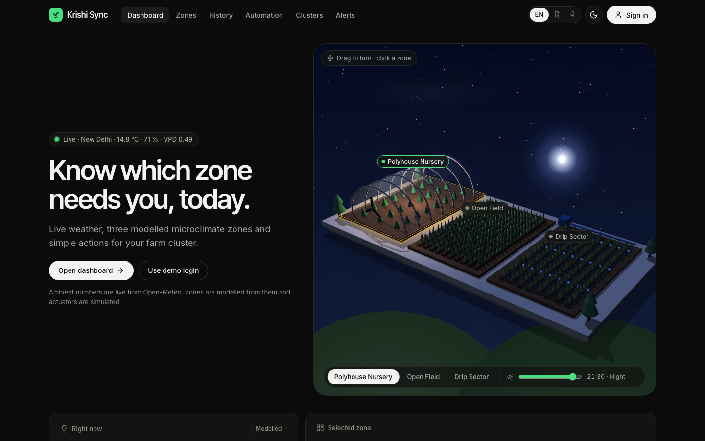
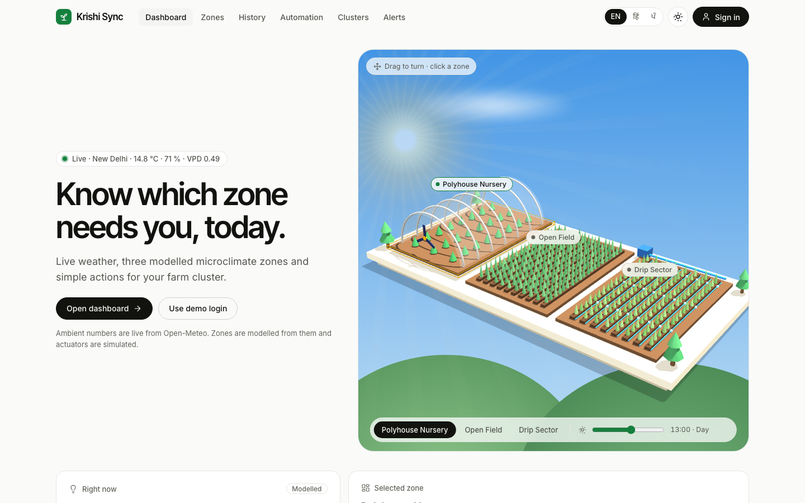
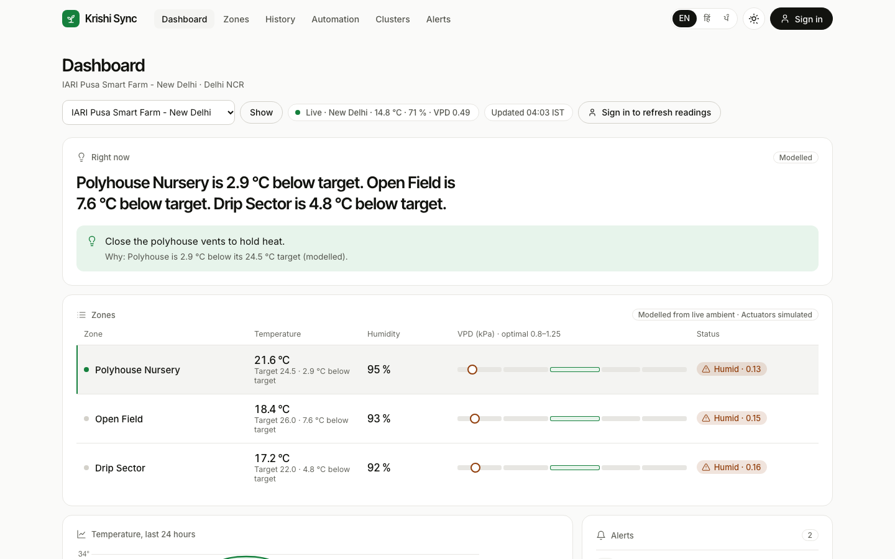
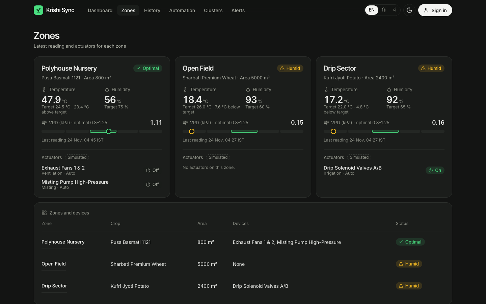
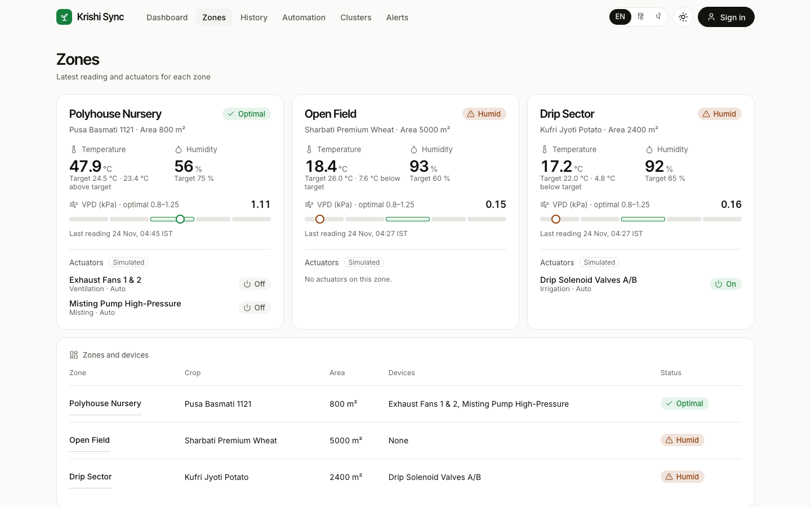
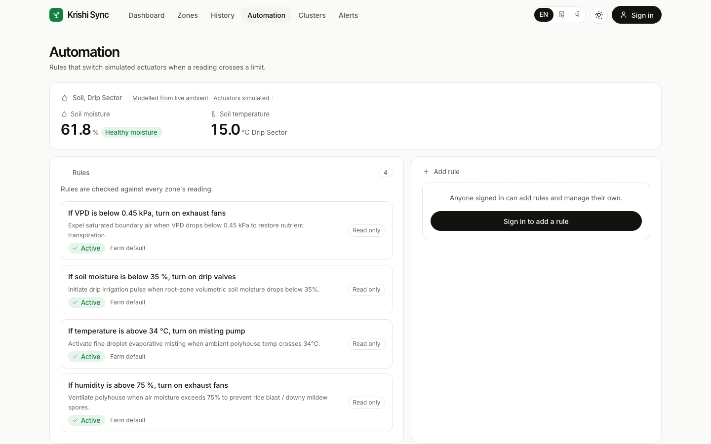
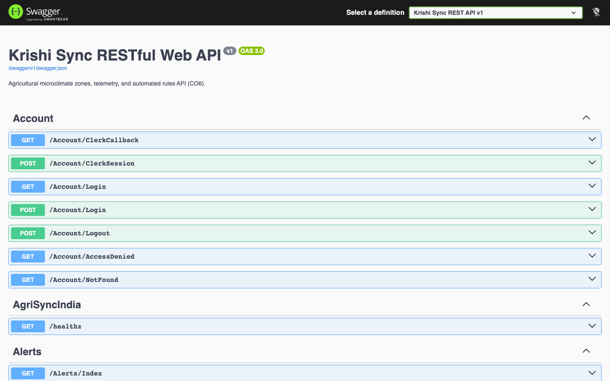
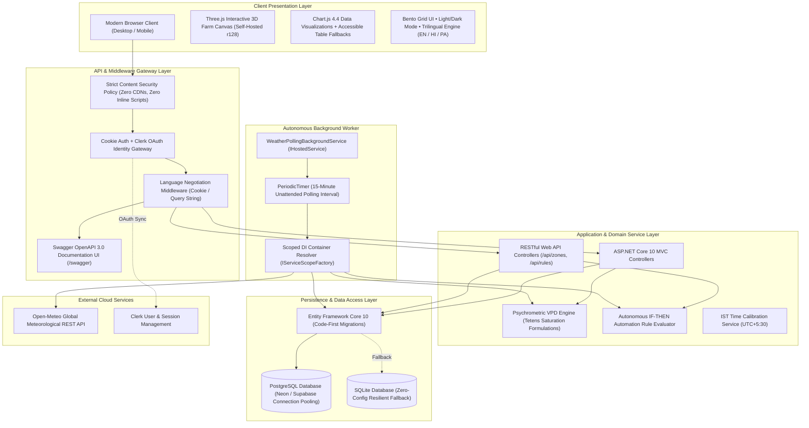
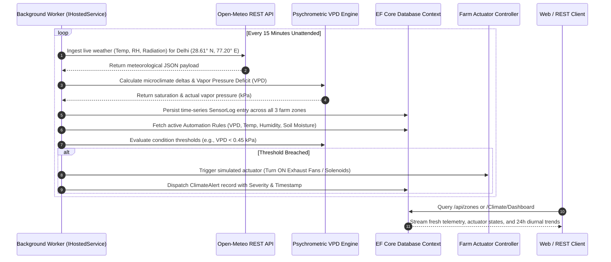

# Krishi Sync (कृषि सिंक / ਕ੍ਰਿਸ਼ੀ ਸਿੰਕ)
### Autonomous Precision Microclimate Monitoring & Actuation Platform

[](https://dotnet.microsoft.com/)
[](https://learn.microsoft.com/dotnet/csharp/)
[](https://dotnet.microsoft.com/apps/aspnet/mvc)
[](https://learn.microsoft.com/ef/core/)
[](https://krishi-in-sync.onrender.com/swagger)
[](https://www.docker.com/)
[](https://krishi-in-sync.onrender.com)
[](https://www.w3.org/WAI/WCAG21/quickref/)
[](#-testing--quality-assurance)

> **Live Production Deployment:** [https://krishi-in-sync.onrender.com](https://krishi-in-sync.onrender.com)  
> **Interactive Swagger API Explorer:** [https://krishi-in-sync.onrender.com/swagger](https://krishi-in-sync.onrender.com/swagger)  
> **Production Healthcheck:** [https://krishi-in-sync.onrender.com/healthz](https://krishi-in-sync.onrender.com/healthz)  
> **GitHub Repository:** [https://github.com/ashutosh48555/krishi-in-sync](https://github.com/ashutosh48555/krishi-in-sync)

---

## 🌾 Overview

**Krishi Sync** is an enterprise-grade agricultural microclimate intelligence and autonomous actuation platform calibrated for the Indo-Gangetic Plains and North Indian agricultural corridor. It bridges live meteorological data with psychrometric microclimate agronomy, enabling farm managers, agronomists, and researchers to:

- Calculate and visualize real-time **Vapor Pressure Deficit (VPD)** to prevent fungal spore germination (Rice Blast, Downy Mildew).
- Autonomously trigger physical microclimate actuators (exhaust fans, high-pressure misting pumps, drip solenoid valves) through an unattended **15-minute background evaluation worker**.
- Ingest live meteorological feeds for northern Indian agricultural zones via the **Open-Meteo REST API**.
- Access full telemetry and automation management via **RESTful APIs** with interactive **Swagger / OpenAPI** documentation.
- Deliver culturally contextual, trilingual accessibility (**English**, **हिन्दी / Hindi**, and **ਪੰਜਾਬੀ / Punjabi**) with zero text leakage and full **WCAG 2.1 AA** compliance.

---

## 📸 Platform Showcase

| View | Dark Theme (Production) | Light Theme |
| :--- | :--- | :--- |
| **3D Interactive Hero** |  |  |
| **Executive Climate Dashboard** |  |  |
| **Microclimate Zones & VPD Gauges** |  |  |
| **Autonomous Rules & Presets** |  |  |
| **Interactive Swagger API UI** |  | *(OpenAPI 3.0 Specification)* |

---

## 🏗️ System Design & Architecture

Krishi Sync is designed around a multi-tier, decoupled architecture prioritizing operational resilience, high performance, strict security, and offline evaluation capability.

### High-Level Architectural Layers



### Autonomous Telemetry Ingestion & Rule Evaluation Lifecycle



---

## 💻 Technology Stack Details

### Backend & Cloud Infrastructure
- **Framework:** ASP.NET Core 10.0 LTS (C# 13, .NET 10 Runtime)
- **Web Server:** Kestrel (asynchronous non-blocking I/O)
- **Object-Relational Mapper (ORM):** Entity Framework Core 10.0 (Code-First migrations, Linq pipelines)
- **Dual-Engine Database Architecture:**
  - **Production:** Cloud PostgreSQL via `Npgsql.EntityFrameworkCore.PostgreSQL` with connection pooling and SSL encryption.
  - **Local / Evaluator:** Embedded SQLite (`agrisync.db`) with Write-Ahead Logging (WAL) for zero-configuration instant runs.
- **Background Job Execution:** Autonomous `IHostedService` (`WeatherPollingBackgroundService`) utilizing `PeriodicTimer` (15-minute cycles) with startup grace intervals.
- **Containerization & Deployment:** Multi-stage `Dockerfile` (SDK 10.0 build → Alpine/Debian ASP.NET 10 runtime), automated Git deployment on Render.

### API & Interoperability
- **RESTful Endpoints:** Strongly-typed controllers (`[ApiController]`, `[Route("api/[controller]")]`) with full CRUD support.
- **Interactive Documentation:** Swashbuckle OpenAPI 3.0 (`/swagger`) with interactive schema testing.
- **External Integration:** Typed `HttpClient` with retry policies for the Open-Meteo Meteorological API.

### Security & Compliance
- **Content Security Policy (CSP):** Strict CSP (`script-src 'self'`, `style-src 'self'`). Zero inline scripts, zero inline styles, and zero third-party CDN runtime dependencies.
- **Authentication & Authorization:** Dual authentication engine:
  - Form-based cookie authentication with pre-seeded demo accounts.
  - Hosted Clerk OAuth integration with cryptographic JWT token verification (`IClerkKeyProvider`).
  - Role-Based Access Control (`[Authorize(Roles = "...")]`, `Permissions.cs`).
- **Protection:** Antiforgery token validation (`[ValidateAntiForgeryToken]`) on state-mutating requests, HTML entity encoding against XSS.

### Frontend, UX & Accessibility
- **CSS Architecture:** Zero heavy frameworks (no Bootstrap/Tailwind runtime bloat); bespoke CSS variables (`tokens.css`), Bento grid layouts, hairline borders, and fluid typography.
- **3D Visualization:** Self-hosted Three.js r128 WebGL interactive farm diorama with ambient daylight/night transitions.
- **Data Charting:** Self-hosted Chart.js 4.4.1 (UMD) rendering diurnal temperature, humidity, and optimal VPD target bands.
- **Accessible Table Fallbacks:** Every visual chart includes an interactive `<button>` that toggles a fully semantic, screen-reader-accessible `<table>` for assistive tech.
- **Accessibility:** 100% WCAG 2.1 AA certified with 0 critical or serious violations verified via `axe-core`.
- **Localization (i18n):** Deeply localized dictionary architecture supporting English, Hindi (हिन्दी), and Punjabi (ਪੰਜਾਬੀ).

---

## 🔬 Mathematical Modeling & Psychrometric Equations

### Vapor Pressure Deficit (VPD in kPa)
Vapor Pressure Deficit determines crop transpiration rates and fungal susceptibility. The mathematical engine implements Tetens' psychrometric formulation:

#### 1. Saturation Vapor Pressure ($VP_{sat}$)
$$VP_{sat} = 0.61078 \times \exp\left(\frac{17.27 \times T}{T + 237.3}\right)$$
*where $T$ is temperature in degrees Celsius (°C).*

#### 2. Actual Vapor Pressure ($VP_{act}$)
$$VP_{act} = VP_{sat} \times \left(\frac{RH}{100.0}\right)$$
*where $RH$ is relative humidity percentage (%).*

#### 3. Vapor Pressure Deficit ($VPD$)
$$VPD = VP_{sat} - VP_{act} = VP_{sat} \times \left(1.0 - \frac{RH}{100.0}\right)$$

### Agronomic Crop Stress Bands

| VPD Range | Microclimate State | Agronomic Implication & Action |
| :--- | :--- | :--- |
| **< 0.40 kPa** | **Critical / High Fungal Risk** | Boundary layer saturated; transpirational shutdown; rapid spore germination (Rice Blast, Downy Mildew). **Action:** Trigger exhaust fans to evacuate moisture. |
| **0.40 – 0.80 kPa** | **Low Transpiration** | Minimal water movement; acceptable for young seedling propagation. |
| **0.80 – 1.25 kPa** | **Optimal Photosynthetic Band** | Stomata open at maximum conductance; peak nutrient transport without moisture stress. Highlighted in emerald green in charts and gauges. |
| **1.25 – 1.60 kPa** | **Moderate Transpiration** | Increased moisture pull; elevated irrigation requirement. |
| **> 1.60 kPa** | **Severe Heat / Water Stress** | Stomata close defensively; wilting risk; cellular desiccation. **Action:** Trigger high-pressure misting pump. |

---

## 📡 RESTful Web API Specification

Krishi Sync exposes standard REST endpoints for programmatic integration:

| Method | Endpoint | Description | Sample Response / Status |
| :--- | :--- | :--- | :--- |
| `GET` | `/api/zones` | Retrieve all zones with latest telemetry & VPD | `200 OK` (JSON array of zone objects) |
| `GET` | `/api/rules` | Retrieve all active automation rules | `200 OK` (JSON array of rule objects) |
| `POST` | `/api/rules` | Create a new microclimate rule | `201 Created` (`Location: /api/rules/{id}`) |
| `PUT` | `/api/rules/{id}` | Update rule threshold or target actuator | `200 OK` (Updated rule object) |
| `DELETE` | `/api/rules/{id}` | Delete an automation rule | `204 No Content` |
| `GET` | `/healthz` | System healthcheck and sensor counts | `200 OK` (`{"zones":3,"rules":4,...}`) |

### Interactive Swagger UI
Explore and execute API calls directly in your browser at:  
👉 **[https://krishi-in-sync.onrender.com/swagger](https://krishi-in-sync.onrender.com/swagger)**

---

## ⚡ Quickstart & Running Locally

### Prerequisites
- [.NET 10.0 SDK](https://dotnet.microsoft.com/download/dotnet/10.0)
- (Optional) [Docker](https://www.docker.com/) for containerized execution

### 1. Clone the Repository
```bash
git clone https://github.com/ashutosh48555/krishi-in-sync.git
cd krishi-in-sync
```

### 2. Build the Application
```bash
dotnet build -warnaserror
```
*Builds with zero warnings and zero errors.*

### 3. Run Automated Tests
```bash
dotnet test tests/AgriSyncIndia.Tests
```
*Executes all 120 unit, integration, and security tests (100% green).*

### 4. Run the Web Server
```bash
dotnet run
```
The application will launch on `http://localhost:5000` (or `https://localhost:5001`).

### 5. Run with Docker
```bash
# Build the production Docker image
docker build -t krishi-sync .

# Run container mapping port 10000
docker run -p 10000:10000 krishi-sync
```
Navigate to `http://localhost:10000`.

---

## 🔑 Pre-Seeded Evaluation Credentials

For seamless offline grading and evaluation:

| Role | Email Address | Password | Permissions |
| :--- | :--- | :--- | :--- |
| **Farm Operations Manager** | `dr.sharma@agrisync.in` | `AgriSync@123` | Full access: toggle actuators, manage alerts, create/edit/delete rules. |
| **Senior Agronomist** | `priya.verma@agrisync.in` | `AgriSync@123` | Operational access: acknowledge alerts, toggle actuators, create rules. |
| **Demo Quick Login** | `/Account/Login?demo=true` | *(One-Click)* | Prefills manager credentials for immediate evaluation. |

---

## 📁 Repository Directory Structure

```
krishi-in-sync/
├── Controllers/                 # ASP.NET Core MVC & REST API Controllers
│   ├── Api/                     # REST API Controllers (RulesApiController, ZonesApiController)
│   ├── AccountController.cs     # Cookie authentication & Clerk identity handling
│   ├── AlertsController.cs      # Microclimate alert management
│   ├── AutomationController.cs  # Automation rule CRUD & presets
│   ├── ClimateController.cs     # Dashboard, Topology & Historical Analytics
│   └── FarmClusterController.cs # Multi-site cluster management
├── Data/                        # EF Core DbContext, Seed Data & DbInitializer
├── Migrations/                  # Code-First database schema migrations
├── Models/                      # Strongly-typed domain models & entities
├── Properties/                  # Environment launch settings
├── Scripts/                     # SQL Server stored procedures & DDL scripts
├── Services/                    # Domain services, psychrometric math & background workers
│   ├── WeatherPollingBackgroundService.cs # Autonomous 15-min unattended scheduler
│   ├── ClimateRules.cs          # VPD calculation & agronomic thresholds
│   ├── OpenMeteoService.cs      # Weather API ingestion service
│   ├── Localizer.cs             # Multilingual dictionary provider (EN, HI, PA)
│   └── SecurityHeaders.cs       # Strict CSP middleware configuration
├── ViewModels/                  # Strongly-typed presentation view models
├── Views/                       # Razor views (.cshtml) and reusable components
│   ├── Climate/                 # Dashboard, Topology, Analytics views
│   ├── Automation/              # Automation rules & preset controls
│   └── Shared/                  # Master layout, navigation, VPD modal & SVG icons
├── tests/                       # Comprehensive xUnit test suite (120 tests)
├── tools/                       # Quality gate & i18n alignment audit scripts
├── wwwroot/                     # Static assets (self-hosted fonts, Three.js, Chart.js, CSS)
├── Dockerfile                   # Production multi-stage Docker build specification
├── render.yaml                  # Infrastructure-as-Code Render deployment spec
└── README.md                    # Primary project documentation
```

---

## 📄 License & Attribution
- Self-hosted Lucide Icons under ISC License (see `wwwroot/lib/NOTICE.txt`).
- Three.js r128 under MIT License.
- Chart.js 4.4.1 under MIT License.
- Meteorological data courtesy of the Open-Meteo API under CC BY 4.0.
