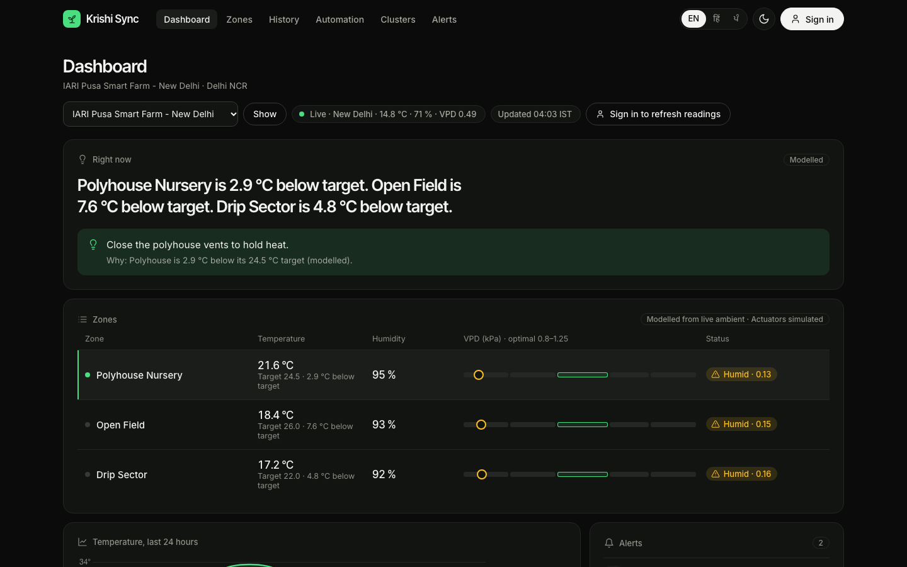
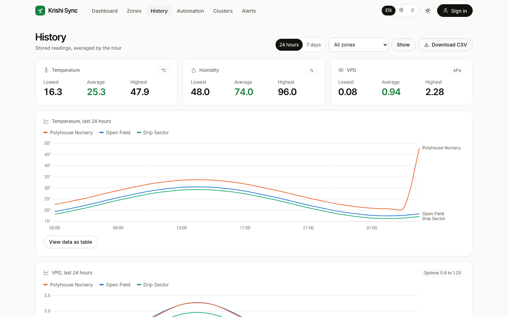
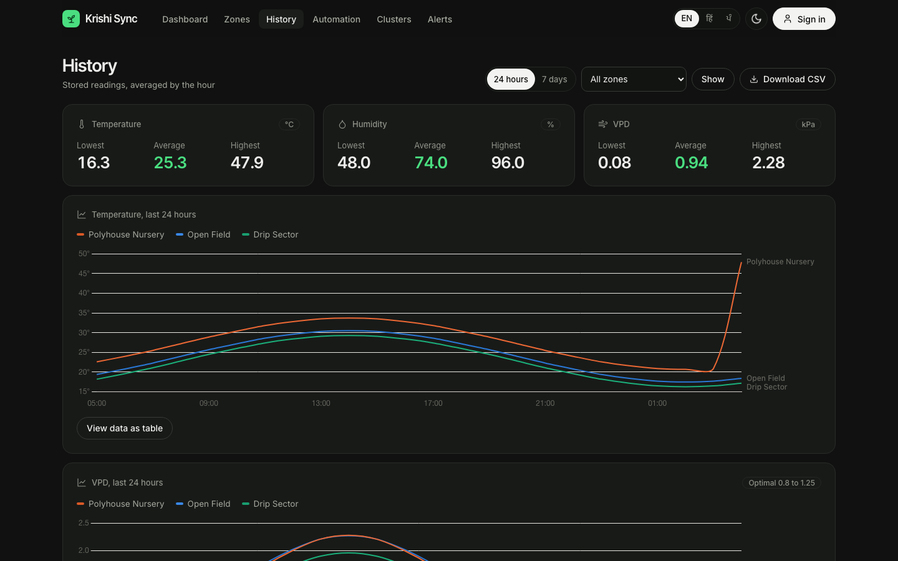
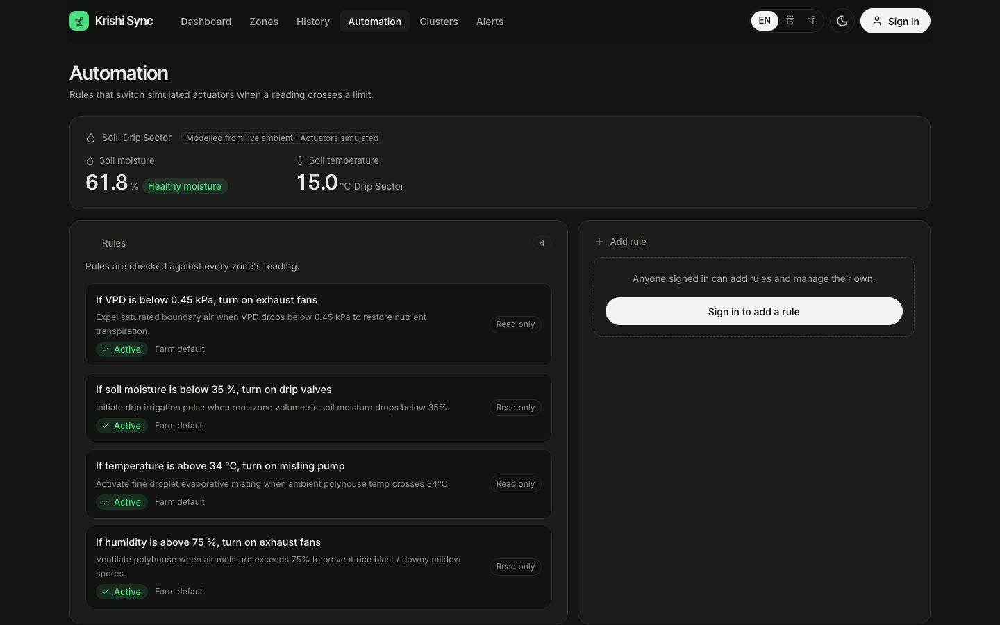
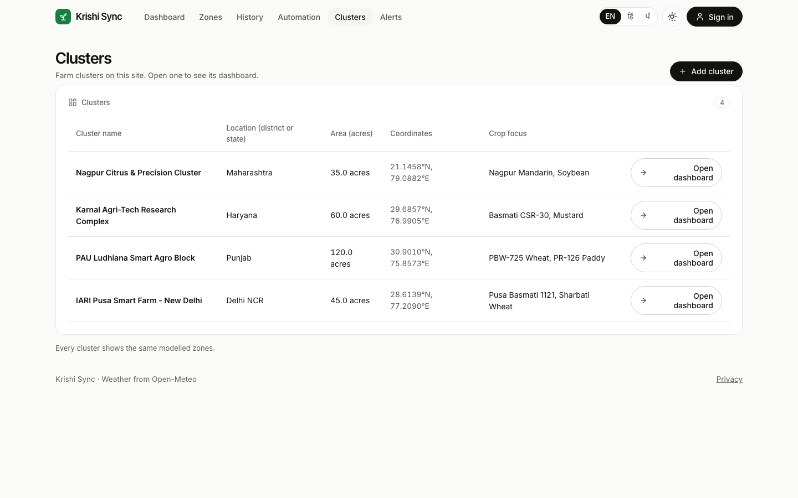
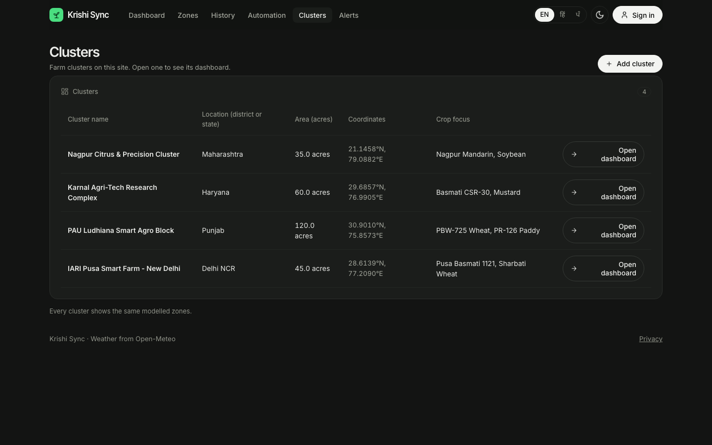

# Krishi Sync (कृषि सिंक / ਕ੍ਰਿਸ਼ੀ ਸਿੰਕ)
### Automated Precision Microclimate Monitoring & Actuation System for Smart Agriculture

> **Live Deployment:** [https://krishi-in-sync.onrender.com](https://krishi-in-sync.onrender.com)  
> **Course / Project:** INT402 Web Development Submission  
> **Repository:** [github.com/ashutosh48555/krishi-in-sync](https://github.com/ashutosh48555/krishi-in-sync)

---

## 🌾 Overview

**Krishi Sync** is an enterprise-grade, accessible agricultural climate intelligence application calibrated for the Indo-Gangetic Plains and North Indian agricultural corridor. It bridges live meteorological feeds with microclimate agronomy to help farm managers, agronomists, and researchers monitor Vapor Pressure Deficit (VPD), automate environmental actuators, track thermal variances, and mitigate fungal spore risks in real-time.

---

## 📸 Screenshots

| View | Light Theme (1440px) | Dark Theme (1440px) |
| :--- | :--- | :--- |
| **Home (3D Hero)** |  |  |
| **Executive Dashboard** |  |  |
| **Historical Analytics** |  |  |
| **Zones & Actuators** |  |  |
| **Automation Rules** |  |  |
| **Farm Clusters** |  |  |

---

## 🏗️ Architecture & Technology Stack

```
+-------------------------------------------------------------------------+
|                              Browser Client                             |
|  - Three.js 3D Interactive Farm Diorama (Self-hosted r128)             |
|  - Vanilla Chart.js 4 (Self-hosted UMD, 0 CDNs, Optimal VPD Band)        |
|  - Accessible Data Tables with Keyboard Navigation & aria-live           |
|  - Strict CSP (script-src 'self', style-src 'self', 0 inline handlers)  |
|  - Tri-lingual UI: English (en) / हिंदी (hi) / ਪੰਜਾਬੀ (pa)              |
+------------------------------------+------------------------------------+
                                     | HTTPS / WSS
+------------------------------------v------------------------------------+
|                         ASP.NET Core MVC (.NET 10)                      |
|  - Strongly-typed Razor Views (.cshtml) & ViewModels                    |
|  - IST Time Calibration (IstClock.Now = UTC+5.5)                        |
|  - Dynamic Headline & Advice Engine (Localized Agronomic Insights)     |
|  - Security Middleware (Strict CSP, Anti-forgery, Ownership Checks)     |
+------------------+----------------------------------+-------------------+
                   |                                  |
+------------------v---------------+  +---------------v-------------------+
|     Data & Cloud Layer           |  |      External Integrations        |
|  - Neon / Supabase Postgres     |  |  - Open-Meteo REST API (Weather)  |
|  - SQLite Fallback (Zero Secret) |  |  - Clerk User Management (OAuth)  |
|  - Neon Realtime Live Updates   |  |  - Seeded Demo Accounts           |
|  - Row Level Security (RLS)      |  |                                   |
+----------------------------------+  +-----------------------------------+
```

- **Backend:** ASP.NET Core 10.0 MVC with C# 13, EF Core Code-First migrations, and asynchronous dependency-injected services.
- **Database:** Postgres (Neon / Supabase) with automatic connection pooling and migrations. Falls back seamlessly to SQLite (`AgriSyncIndia.db`) for zero-configuration offline runs.
- **Authentication:** Hosted Clerk authentication + resilient local demo login for evaluators.
- **Frontend & CSS:** Custom design tokens (`tokens.css`), Bento grids, hairline borders, and fluid typography. Zero Bootstrap or jQuery in core layout.
- **Security & Content Security Policy:** Strict CSP (`script-src 'self'`, `style-src 'self'`). Zero inline scripts, zero inline styles, and zero third-party CDN runtime dependencies.
- **Accessibility:** 100% WCAG 2.1 AA compliant verified by `axe-core` across all 24 page configurations (12 pages in light and dark themes) with 0 serious or critical violations. Full keyboard navigation and screen-reader accessible data table toggles on all canvas charts.

---

## 🎓 INT402 Syllabus Alignment & Course Outcomes

This application is built for **INT402: Modern Web Programming Tools and Techniques** (C# / .NET Stack). It comprehensively demonstrates all 6 Course Outcomes (CO1 to CO6) prescribed in the university curriculum:

| Course Outcome (CO) | Syllabus Unit & Bloom Level | Curriculum Criterion | Project Implementation & Code Location |
| :--- | :--- | :--- | :--- |
| **CO1** | **Unit 1** (UNDERSTAND) | .NET Core architecture, C# fundamentals, CLI setup | Built on **.NET 10** (`net10.0`, C# 13). Complete CLI-based developer lifecycle (`dotnet build`, `dotnet test`, `dotnet run`, `dotnet publish`, `dotnet ef`). Configuration in `AgriSyncIndia.csproj` and `launchSettings.json`. |
| **CO2** | **Unit 2** (APPLY) | Core C# programming constructs & OOP principles | Strongly typed domain entities with encapsulation (`Models/*.cs`), interfaces & polymorphism (`IOpenMeteoService`, `IClerkKeyProvider`), psychrometric math algorithms (`ClimateRules.cs`), custom LINQ pipelines, and try-catch error resilience. |
| **CO3** | **Unit 3** (CREATE) | ASP.NET Core MVC Razor views, data-passing, form validation & model binding | ASP.NET Core MVC with Razor (`.cshtml`), partial views (`_Stage.cshtml`, `_HeadlineCard.cshtml`, `_ChartCard.cshtml`), ViewModels (`DashboardViewModel.cs`, etc.), `ViewData`, `TempData` flash messages, and model validation with DataAnnotations (`[Required]`, `[Range]`, `ModelState.IsValid`). |
| **CO4** | **Unit 4** (APPLY) | Middleware, Dependency Injection & Authentication/Authorization | Custom request middleware (`LanguageMiddleware.cs`, `SecurityHeaders.cs`), built-in DI container (scoped `DbContext`, singleton options/validators, typed HTTP clients), Cookie & Clerk authentication, and role authorization (`[Authorize]`, `Permissions.cs`). |
| **CO5** | **Unit 5** (CREATE) | SQL Server database design — tables, views, stored procedures | 8 normalized relational database tables. SQL Server stored procedures and DDL scripts in `Scripts/CreateStoredProcedures.sql` (`dbo.Get24HourZoneLogs`, `dbo.GetAggregatedClimateStats`) and `Scripts/InitialMigration_SqlServer.sql`. Multi-provider EF Core support (Postgres, SQLite, SQL Server). |
| **CO6** | **Unit 6 & 7** (CREATE) | RESTful Web APIs with CRUD functionality validated using Postman | REST API controllers (`[ApiController]`, `[Route("api/[controller]")]`) in `Controllers/Api/RulesApiController.cs` (full CRUD: GET, POST, PUT, DELETE with JSON payloads) and `Controllers/Api/ZonesApiController.cs`. |

### 📬 Testing RESTful Web APIs with Postman / curl (CO6)

The application exposes standard RESTful endpoints for automated API validation in Postman or curl:

```bash
# 1. GET all zones with latest telemetry
curl -s http://localhost:5000/api/zones

# 2. GET all automation rules
curl -s http://localhost:5000/api/rules

# 3. POST - Create a new automation rule (201 Created)
curl -X POST http://localhost:5000/api/rules \
  -H "Content-Type: application/json" \
  -d '{"conditionVariable":"Temperature","operator":">","thresholdValue":35.0,"actionTarget":"Turn ON Exhaust Fans","description":"Created via Postman"}'

# 4. PUT - Update an automation rule
curl -X PUT http://localhost:5000/api/rules/1 \
  -H "Content-Type: application/json" \
  -d '{"thresholdValue":37.5,"description":"Updated threshold via API"}'

# 5. DELETE - Remove an automation rule (204 No Content)
curl -X DELETE -i http://localhost:5000/api/rules/1
```

---

## 🔑 Demo & Evaluation Credentials

For evaluators or offline grading without external OAuth keys:

| Account Role | Email Address | Password | Permissions |
| :--- | :--- | :--- | :--- |
| **Farm Operations Manager** | `dr.sharma@agrisync.in` | `AgriSync@123` | Full access: toggle actuators, manage alerts, create/delete rules. |
| **Senior Agronomist** | `priya.verma@agrisync.in` | `AgriSync@123` | Operational access: acknowledge alerts, toggle actuators, create rules. |
| **Clerk / New User** | *(Any Clerk sign-in)* | *(Clerk OTP/OAuth)* | Viewer role: read telemetry, add personal rules, edit/delete owned rules. |

### ⚡ 60-Second Evaluator Path
1. Visit `/Account/Login?demo=true` (credentials prefilled). Click **Sign In**.
2. Review the **Executive Dashboard** (`/Climate/Dashboard`): note the live Open-Meteo ambient readings, zone status badges, and 24-hour diurnal charts.
3. Toggle "View data as table" below the temperature or VPD chart to test the accessible tabular fallback.
4. Navigate to **Automation** (`/Automation`): view root-zone soil telemetry and active IF-THEN rules.
5. In the "Add Rule" form: select *Temperature > 32.5 °C*, choose *Exhaust Fan*, enter a description, and submit.
6. Verify the rule appears in the list, then click **Delete** (with confirmation) to clean up.
7. Click the **Sun/Moon** button in the header to view the theme transition between Light and Dark mode.
8. Switch language between **EN**, **हिं**, and **ਪੰ** in the navigation bar.

---

## 🔬 Mathematical Modeling & Agronomic Honesty

### Vapor Pressure Deficit (VPD in kPa)
VPD drives transpiration and nutrient flow. Computed in `OpenMeteoService.cs`:

$$VP_{sat} = 0.61078 \times \exp\left(\frac{17.27 \times T}{T + 237.3}\right)$$

$$VP_{act} = VP_{sat} \times \left(\frac{RH}{100.0}\right)$$

$$VPD = VP_{sat} - VP_{act} = VP_{sat} \times \left(1.0 - \frac{RH}{100.0}\right)$$

### Transpiration & Crop Stress Bands
- **< 0.40 kPa (Severe / Fungal Risk):** Spore germination risk (Rice Blast, Powdery Mildew).
- **0.40 – 0.80 kPa (Low):** Vegetative range, low transpiration.
- **0.80 – 1.25 kPa (Optimal Band):** Peak stomatal conductance and photosynthesis. Highlighted with shaded green band on charts.
- **1.25 – 1.60 kPa (Moderate):** Elevated moisture demand.
- **> 1.60 kPa (Severe):** Heat stress, stomatal closure, risk of wilting.

### ⚠️ Note on Simulation
- Ambient weather telemetry is retrieved live from the **Open-Meteo REST API** for coordinates 28.6139° N, 77.2090° E (Delhi / Indo-Gangetic Basin).
- Microclimate zones (Polyhouse $+3.2^\circ\text{C}$, Open Field $0^\circ\text{C}$, Drip Sector $-1.2^\circ\text{C}$) and physical actuators (fans, pumps, solenoids) are mathematically modelled software simulations representing IoT hardware.

---

## 🚀 Running Locally

### Prerequisites
- [.NET 10.0 SDK](https://dotnet.microsoft.com/download/dotnet/10.0) (or .NET 8/9 runtime)
- Node.js 18+ (only for Playwright / axe-core verification scripts in `tools/`)

### 1. Clone & Build
```bash
git clone https://github.com/ashutosh48555/krishi-in-sync.git
cd krishi-in-sync
dotnet build -warnaserror
```

### 2. Run Tests
```bash
dotnet test tests/AgriSyncIndia.Tests
```
*Expected: 118 of 118 unit and integration tests passing with 0 warnings.*

### 3. Start the Web Server
```bash
dotnet run
```
Open [http://localhost:5000](http://localhost:5000) (or the port logged in your console).

### 4. Run Automated A11y & Quality Gate Audit
```bash
node tools/verify-phase4-phase5.mjs
```
*Audits all 12 views in light and dark mode with axe-core, verifies zero network leaks, confirms strict CSP compliance, and validates the evaluator path.*

---

## 📄 License & Attribution
- Self-hosted Lucide Icons under ISC License (see `wwwroot/lib/NOTICE.txt`).
- Three.js r128 under MIT License.
- Chart.js 4.4.1 under MIT License.
- Weather data courtesy of Open-Meteo API under CC BY 4.0.
